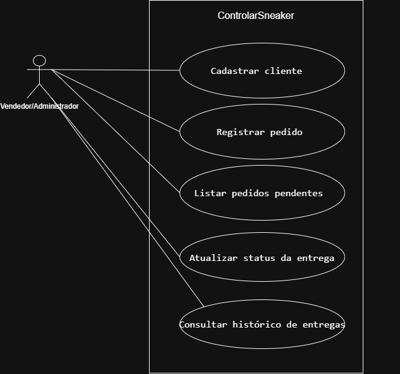

# 4.2.2 Modelagem de Casos de Uso

## Atores

O ControlarSneaker possui como ator o Vendedor/Administrador, que é responsável pelo controle dos clientes, pedidos e entregas da loja.

| Ator | Quem é | O que faz no sistema |
|---|---|---|
| Vendedor/Administrador | Proprietário é vendedor responsável pelos pedidos da loja | Cadastra clientes, registra pedidos, lista pedidos pendentes, atualiza o status das entregas e consulta o histórico de entregas |

## Casos de uso

| Caso de uso | Ator | Atende |
|---|---|---|
| Cadastrar cliente | Vendedor/Administrador | RF01 |
| Registrar pedido | Vendedor/Administrador | RF02 |
| Listar pedidos pendentes | Vendedor/Administrador | RF03 |
| Atualizar status da entrega | Vendedor/Administrador | RF04 |
| Consultar histórico de entregas | Vendedor/Administrador | RF05 |

## Diagrama de casos de uso

**Figura 1 – Diagrama de casos de uso do ControlarSneaker**

Fonte: Autoria própria (2026).

A Figura 1 apresenta o Vendedor/Administrador como ator do sistema. Dentro da fronteira do ControlarSneaker estão os cinco casos de uso relacionados ao controle dos clientes, pedidos e entregas. O ator está ligado aos casos de uso por linhas de associação sem ponta. Não foram utilizados «include» ou «extend», pois não foi identificado um comportamento compartilhado ou opcional que precise desses relacionamentos.

## Especificação do caso de uso principal

Registrar pedido foi escolhido como o caso de uso principal porque o controle dos pedidos e das entregas é o objetivo central do ControlarSneaker.

| Campo | |
|---|---|
| Caso de uso | Registrar pedido |
| Ator | Vendedor/Administrador |
| Pré-condição | O Vendedor/Administrador está identificado no sistema (RNF02) e o cliente está cadastrado (RF01). |
| Pós-condição | O pedido está registrado e vinculado ao cliente com as informações necessárias para a entrega. |

**Fluxo principal**

1. O Vendedor/Administrador identifica o cliente.
2. O sistema apresenta os dados cadastrados do cliente.
3. O Vendedor/Administrador informa os dados do pedido.
4. O sistema verifica os dados informados.
5. O Vendedor/Administrador informa os dados da entrega.
6. O sistema verifica os dados da entrega.
7. O Vendedor/Administrador confirma o pedido.
8. O sistema registra o pedido vinculado ao cliente.

**Fluxo alternativo**

- **A1, no passo 2: o cliente não está cadastrado.** O Vendedor/Administrador cadastra o cliente (Cadastrar cliente, RF01) e o fluxo volta ao passo 1.

**Fluxos de exceção**

- **E1, no passo 6: existem dados necessários para a entrega que não foram informados.** O sistema informa que os dados estão incompletos e não registra o pedido. O caso de uso termina sem a pós-condição.

Ainda é necessário confirmar com o cliente quais dados do pedido e da entrega são obrigatórios para permitir o registro.

## Rastreabilidade com a 4.2.1

| Requisito | Caso de uso | Onde aparece |
|---|---|---|
| RF01 Cadastrar cliente | Cadastrar cliente | Elipse e fluxo alternativo A1 de Registrar pedido |
| RF02 Registrar pedido | Registrar pedido | Elipse e especificação do caso de uso principal |
| RF03 Listar pedidos pendentes | Listar pedidos pendentes | Elipse |
| RF04 Atualizar status da entrega | Atualizar status da entrega | Elipse |
| RF05 Consultar histórico de entregas | Consultar histórico de entregas | Elipse |

Todo requisito tem lugar. Os cinco requisitos funcionais possuem um caso de uso correspondente.

Toda elipse tem requisito. As cinco elipses correspondem aos requisitos RF01 até RF05.

A especificação mostrou que ainda é necessário confirmar quais informações do pedido e da entrega são obrigatórias. Essa dúvida já estava indicada na seção 4.2.1 e continua marcada com ? para ser confirmada com o cliente.