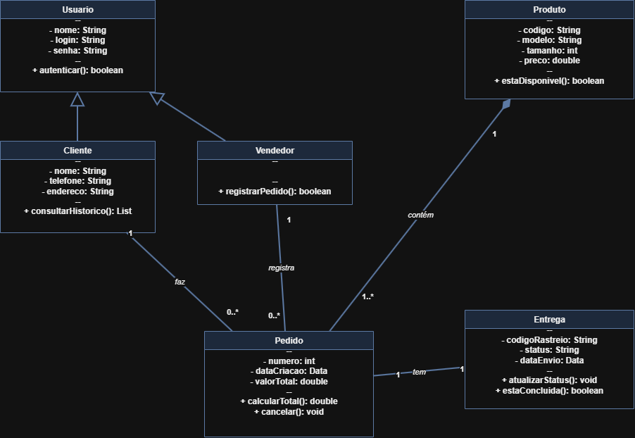

# 4.2.3 Modelagem de Classes

## Dos substantivos às classes

Para descobrir o que o sistema precisa guardar, eu olhei direto para os passos do fluxo de "Registrar pedido" (lá da 4.2.2) e para os requisitos da 4.2.1. Cada coisa que o vendedor digita ou que a tela precisa mostrar vira um forte candidato a classe.

Mas nem todo substantivo vira uma caixa no diagrama. Passamos as palavras por três filtros rápidos:
1. **É detalhe?** Virou atributo (ex: o telefone é detalhe do cliente).
2. **É tela ou botão?** Ficou de fora (são só interfaces).
3. **Tá fora do sistema?** Ficou de fora.

| Substantivo | De onde veio | Vira | Por quê |
|---|---|---|---|
| cliente | passo 1 do fluxo, HU01, RF01 | classe **Cliente** | Precisamos guardar quem compra, o contato e o endereço de entrega |
| vendedor / administrador | ator da 4.2.2, pré-condição, RNF02 | classe **Usuario** e classe **Vendedor** | O sistema precisa saber quem tá logado para liberar o registro de vendas |
| nome, telefone, endereço | passo 2 do fluxo, RF01 | atributos de **Cliente** | São as informações de contato e entrega |
| pedido | passo 3 e 7 do fluxo, HU02, RF02 | classe **Pedido** | É o coração da venda: conecta cliente, tênis e entrega |
| produto / sneaker | escopo da 4.1, HU02, RF02 | classe **Produto** | O tênis que tá sendo vendido na loja |
| entrega / status | passo 5 e 6 do fluxo, HU04, RF04 | classe **Entrega** | Guarda o endereço final, código de rastreio e a situação do envio |
| dados da entrega | passo 5 do fluxo | atributos de **Entrega** | São os detalhes do frete, não uma coisa solta no sistema |

## Classes

Fechamos o sistema em 5 classes principais. Para organizar os acessos, `Vendedor` herda de `Usuario` (atendendo ao `RNF02` de perfil restrito). Cada atributo e método veio direto das necessidades da loja.

| Classe | Atributos | Operações | Veio de |
|---|---|---|---|
| **Usuario** | - nome: String, - login: String, - senha: String | + autenticar(): boolean | RNF02 (login seguro) |
| **Vendedor** | _herda de Usuario_ | + registrarPedido(): boolean | Ator da 4.2.2 e passo 7 do fluxo |
| **Cliente** | - nome: String, - telefone: String, - endereco: String | + consultarHistorico(): List | passos 1 e 2 do fluxo, HU01, RF01 |
| **Produto** | - codigo: String, - modelo: String, - tamanho: int, - preco: double | + estaDisponivel(): boolean | HU02, RF02 (dados do estoque/tênis) |
| **Pedido** | - numero: int, - dataCriacao: Data, - valorTotal: double | + calcularTotal(): double, + cancelar(): void | passos 3 e 7 do fluxo, RF02, RF03 |
| **Entrega** | - codigoRastreio: String, - status: String, - dataEnvio: Data | + atualizarStatus(): void, + estaConcluida(): boolean | passos 5 e 6 do fluxo, RF04, RF05 |

## Diagrama de classes

**Figura 2 – Diagrama de classes do ControlarSneaker**

Fonte: Autoria própria (2026).

O diagrama mostra como essas peças se conversam no dia a dia da loja:

* **Associações:** Um `Cliente` pode fazer vários (`0..*`) `Pedido`s, mas cada `Pedido` pertence a um (`1`) único `Cliente`. Da mesma forma, o `Vendedor` registra vários (`0..*`) `Pedido`s. Já o `Pedido` junta um ou mais (`1..*`) `Produto`s.
* **Herança:** Usamos a seta de triângulo vazado apontando para `Usuario`. Isso significa que o `Vendedor` é um tipo de usuário e aproveita o mesmo login e senha.
* **Composição:** O losango preenchido do lado do `Pedido` mostra que a `Entrega` depende 100% dele. Se um pedido for apagado do sistema, a entrega dele morre junto. ❓ *Dúvida para alinhar com o Kauê:* se o pedido for cancelado antes de enviar, a gente só muda o status da entrega para "Cancelada" ou apaga o registro?

Não colocamos agregação porque não existe entrega nem produto navegando solto sem estar vinculado a um pedido ou cliente.

## Teste de objetos

Para ter certeza de que essa estrutura funciona na prática, testamos as regras com um cenário real da loja:

* **Reuso de cadastro:** Um cliente faz várias compras sem precisarmos cadastrar o nome e endereço dele de novo a cada pedido.
* **Responsabilidade clara:** O pedido fica amarrado exatamente ao vendedor que atendeu e ao comprador.
* **Rastreio isolado:** A entrega gerada com status ("
