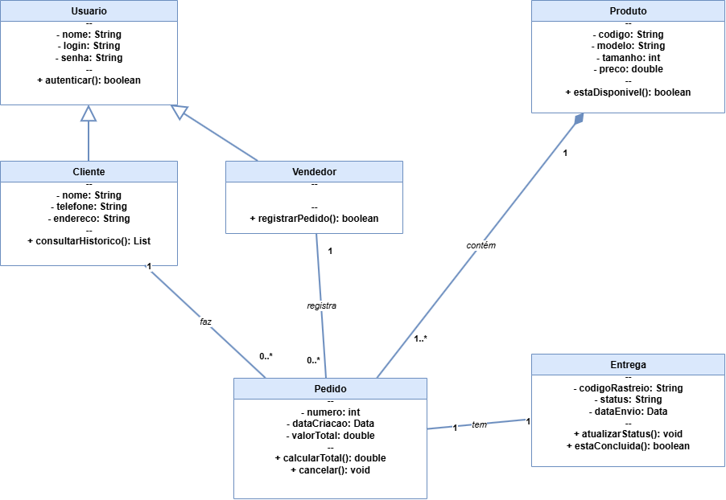

# 4.2.3 Modelagem de Classes

## Dos substantivos às classes

<<<<<<< HEAD
As classes saem dos substantivos. A fonte principal é o fluxo de Registrar pedido, especificado na 4.2.2. Cada coisa que o ator informa ou que o sistema confirma é uma coisa que o sistema precisa lembrar. A segunda fonte é a lista de requisitos da 4.2.1. O que aparece nas duas vira classe com mais confiança.

Nem todo substantivo vira classe. Três filtros: o que é detalhe de outra coisa vira atributo (o telefone é detalhe do cliente). O que é interface não entra (tela, botão, relatório). O que está fora do sistema também não.

| Substantivo | De onde veio | Vira | Por quê |
|---|---|---|---|
| cliente | passo 1 do fluxo, HU01, RF01 | classe **Cliente** | o sistema guarda quem ele é, seu endereço e dados de contato para entregas |
| vendedor / administrador | ator da 4.2.2, pré-condição, RNF02 | classe **Usuario** e classe **Vendedor** | o sistema precisa saber quem é o usuário autenticado que registra pedidos e atualiza status |
| nome, telefone, endereço | passo 2 do fluxo ("apresenta os dados cadastrados"), RF01 | atributos de **Cliente** | são os detalhes cadastrais necessários para contato e envio do tênis |
| pedido | passo 3 e 7 do fluxo, HU02, RF02, RF03 | classe **Pedido** | é a venda registrada: vincula o cliente aos itens e à sua entrega |
| produto / sneaker | escopo da 4.1, HU02, RF02 | classe **Produto** | o tênis comercializado pela loja que compõe o pedido |
| entrega / status | passo 5 e 6 do fluxo, HU04, RF04, RF05 | classe **Entrega** | o registro com endereço, status, datas e histórico de transporte |
| dados da entrega | passo 5 ("informa os dados da entrega") | atributos de **Entrega** | são detalhes como endereço final e status da entrega, não algo isolado |

## Classes

Cinco classes cobrem o escopo do ControlarSneaker. A classe `Vendedor` herda de `Usuario` para validar o perfil restrito de acesso exigido no `RNF02`. Cada atributo e operação possui origem rastreável na 4.2.2 ou na 4.2.1.

| Classe | Atributos | Operações | Veio de |
|---|---|---|---|
| **Usuario** | - nome: String, - login: String, - senha: String | + autenticar(): boolean | RNF02 (acesso restrito ao perfil cadastrado) |
| **Vendedor** | _herda de Usuario_ | + registrarPedido(): boolean | Ator da 4.2.2, HU02 e passo 7 do fluxo principal |
| **Cliente** | - nome: String, - telefone: String, - endereco: String | + consultarHistorico(): List | passo 1, 2 do fluxo, HU01, HU05, RF01 e RF05 |
| **Produto** | - codigo: String, - modelo: String, - tamanho: int, - preco: double | + estaDisponivel(): boolean | HU02, RF02 (dados do pedido de tênis) |
| **Pedido** | - numero: int, - dataCriacao: Data, - valorTotal: double | + calcularTotal(): double, + cancelar(): void | passos 3, 7 do fluxo, HU02, HU03, RF02 e RF03 |
| **Entrega** | - codigoRastreio: String, - status: String, - dataEnvio: Data | + atualizarStatus(): void, + estaConcluida(): boolean | passos 5, 6 do fluxo, HU04, HU05, RF04 e RF05 |
=======
Para descobrir o que o sistema precisa guardar, eu olhei direto para os passos do fluxo de "Registrar pedido" (lá da 4.2.2) e para os requisitos da 4.2.1. Cada coisa que o vendedor digita ou que a tela precisa mostrar vira um forte candidato a classe.

Mas nem todo substantivo vira uma caixa no diagrama. Passamos as palavras por três filtros rápidos:
1. **É detalhe?** Virou atributo (ex: o telefone é detalhe do cliente).
2. **É tela ou botão?** Ficou de fora (são só interfaces).
3. **Tá fora do sistema?** Ficou de fora.

| Substantivo | De onde veio | Vira | Por quê |
|---|---|---|---|
| cliente | passo 1 do fluxo, HU01, RF01 | classe **Cliente** | Precisamos guardar quem compra, o contato e o endereço de entrega |
| vendedor / administrador | ator da 4.2.2, pré-condição, RNF02 | classe **Usuario** e classe **Vendedor** | O sistema precisa saber quem tá logado para liberar o registro de vendas |
| nome, telefone, endereço | passo 2 do fluxo, RF01 | atributos de **Cliente** | São as informações de contato e entrega |
| pedido | passo 3 e 7 do fluxo, HU02, RF02 | classe **Pedido** | É o coração da venda: conecta cliente, tênis e entrega |
| produto / sneaker | escopo da 4.1, HU02, RF02 | classe **Produto** | O tênis que tá sendo vendido na loja |
| entrega / status | passo 5 e 6 do fluxo, HU04, RF04 | classe **Entrega** | Guarda o endereço final, código de rastreio e a situação do envio |
| dados da entrega | passo 5 do fluxo | atributos de **Entrega** | São os detalhes do frete, não uma coisa solta no sistema |

## Classes

Fechamos o sistema em 5 classes principais. Para organizar os acessos, `Vendedor` herda de `Usuario` (atendendo ao `RNF02` de perfil restrito). Cada atributo e método veio direto das necessidades da loja.

| Classe | Atributos | Operações | Veio de |
|---|---|---|---|
| **Usuario** | - nome: String, - login: String, - senha: String | + autenticar(): boolean | RNF02 (login seguro) |
| **Vendedor** | _herda de Usuario_ | + registrarPedido(): boolean | Ator da 4.2.2 e passo 7 do fluxo |
| **Cliente** | - nome: String, - telefone: String, - endereco: String | + consultarHistorico(): List | passos 1 e 2 do fluxo, HU01, RF01 |
| **Produto** | - codigo: String, - modelo: String, - tamanho: int, - preco: double | + estaDisponivel(): boolean | HU02, RF02 (dados do estoque/tênis) |
| **Pedido** | - numero: int, - dataCriacao: Data, - valorTotal: double | + calcularTotal(): double, + cancelar(): void | passos 3 e 7 do fluxo, RF02, RF03 |
| **Entrega** | - codigoRastreio: String, - status: String, - dataEnvio: Data | + atualizarStatus(): void, + estaConcluida(): boolean | passos 5 e 6 do fluxo, RF04, RF05 |
>>>>>>> 061d9e53084ca86fd6231140098151ecf31edada

## Diagrama de classes

**Figura 2 – Diagrama de classes do ControlarSneaker**

Fonte: Autoria própria (2026).

<<<<<<< HEAD
A Figura 2 apresenta as cinco classes do ControlarSneaker interligadas por associações, herança e composição.

As **associações** representam as ligações diretas do domínio da loja. Um `Cliente` faz zero ou vários (`0..*`) `Pedido`, enquanto cada `Pedido` pertence a exatamente um (`1`) `Cliente`. O `Vendedor` registra zero ou vários (`0..*`) `Pedido`, e cada `Pedido` é registrado por exatamente um (`1`) `Vendedor`. Cada `Pedido` é composto por um ou vários (`1..*`) `Produto`.

A **herança** é representada pelo triângulo vazado apontando para `Usuario`. `Vendedor` é um tipo de usuário do sistema, herdando nome, login e senha, mantendo centralizada a regra de autenticação (`RNF02`).

A **composição** é representada pelo losango cheio do lado de `Pedido` na relação com `Entrega`: a entrega é parte integrante do pedido. Se um registro de pedido for removido do sistema, a sua entrega associada deixa de existir (morre junto). ❓ A confirmar com o cliente Kauê: se um pedido for cancelado antes da separação, a entrega é alterada para o status "Cancelada" ou o objeto de entrega nem chega a ser criado?

Não há **agregação** no modelo, pois não existem entregas ou itens transitando soltos sem vínculo com um pedido ou cliente cadastrado.

## Teste de objetos

Um diagrama de classes é uma promessa sobre o mundo. O jeito de testar essa promessa é pegar uma situação real descrita pelo Kauê e desenhar os objetos correspondentes.

A situação: O vendedor Kauê registra o pedido #101 para o cliente Matheus, contendo um tênis "Nike Dunk Low" (tamanho 41). A entrega é gerada com o status "Pendente" no endereço informado.

**Figura 3 – Diagrama de objetos: registro de um pedido na loja**

Fonte: Autoria própria (2026).

| Objeto | Classe | Valores |
|---|---|---|
| `kaue` | Vendedor | nome = "Kauê Silva", login = "kaue.admin" |
| `matheus` | Cliente | nome = "Matheus Oliveira", telefone = "(42) 99888-1234", endereco = "Rua Balduíno Taques, 500" |
| `dunkLow` | Produto | codigo = "SNK-041", modelo = "Nike Dunk Low", tamanho = 41, preco = 899.90 |
| `ped101` | Pedido | numero = 101, dataCriacao = "26/10/2026", valorTotal = 899.90 |
| `ent101` | Entrega | codigoRastreio = "TRK-101BR", status = "Pendente", dataEnvio = "26/10/2026" |

**Ligações:** `kaue` e `ped101`, `matheus` e `ped101`, `ped101` e `dunkLow`, `ped101` e `ent101`.

**O que o teste confirma**

- **Um cliente faz vários pedidos.** O cliente `matheus` está associado ao pedido `ped101` sem duplicar seu cadastro de endereço (`RF01`).
- **Cada pedido possui um responsável e um destinatário.** O pedido `ped101` liga-se exatamente a um `Vendedor` (`kaue`) e a um `Cliente` (`matheus`).
- **A entrega reflete a solicitação do cliente.** A entrega `ent101` guarda o endereço e o status "Pendente" para viabilizar a listagem exigida pelo `RF03`.
- **O tênis está associado ao pedido.** O sneaker `dunkLow` está vinculado ao `ped101` mantendo o valor contratado.

## Rastreabilidade com a 4.2.2

| Operação ou atributo | Classe | De onde veio |
|---|---|---|
| autenticar() | Usuario | RNF02: acesso e alterações restritos ao perfil cadastrado |
| registrarPedido() | Vendedor | passo 7 do fluxo principal de Registrar pedido, HU02, RF02 |
| consultarHistorico() | Cliente | passo 2 do fluxo, HU05 e RF05 (consultar histórico) |
| estaDisponivel() | Produto | passo 4 do fluxo (verificação de dados do pedido) |
| calcularTotal(), cancelar() | Pedido | passos 3 e 7 de Registrar pedido, HU03, RF02, RF03 |
| atualizarStatus(), estaConcluida() | Entrega | passos 5 e 6 do fluxo, HU04, RF04 (atualizar status) |

**Toda operação tem origem.** Nenhuma operação apareceu sem respaldar os passos da especificação da 4.2.2 ou da lista de requisitos da 4.2.1.

**Todo passo do sistema tem casa.** Os passos 2, 4, 6 e 8 do fluxo principal (onde o sistema apresenta, verifica ou registra) foram mapeados em métodos das classes `Cliente`, `Produto`, `Entrega` e `Pedido`.

**O que a modelagem mudou.** A especificação detalhada da 4.2.2 exigiu criar a classe `Produto` (sneaker) separada de `Pedido` para representar o item comercializado. Além disso, a `Entrega` virou uma classe própria com composição em `Pedido`, garantindo o atendimento direto aos requisitos `RF03` (listar pendentes por endereço) e `RF04` (atualizar status).
=======
O diagrama mostra como essas peças se conversam no dia a dia da loja:

* **Associações:** Um `Cliente` pode fazer vários (`0..*`) `Pedido`s, mas cada `Pedido` pertence a um (`1`) único `Cliente`. Da mesma forma, o `Vendedor` registra vários (`0..*`) `Pedido`s. Já o `Pedido` junta um ou mais (`1..*`) `Produto`s.
* **Herança:** Usamos a seta de triângulo vazado apontando para `Usuario`. Isso significa que o `Vendedor` é um tipo de usuário e aproveita o mesmo login e senha.
* **Composição:** O losango preenchido do lado do `Pedido` mostra que a `Entrega` depende 100% dele. Se um pedido for apagado do sistema, a entrega dele morre junto. ❓ *Dúvida para alinhar com o Kauê:* se o pedido for cancelado antes de enviar, a gente só muda o status da entrega para "Cancelada" ou apaga o registro?

Não colocamos agregação porque não existe entrega nem produto navegando solto sem estar vinculado a um pedido ou cliente.

## Teste de objetos

Para ter certeza de que essa estrutura funciona na prática, testamos as regras com um cenário real da loja:

* **Reuso de cadastro:** Um cliente faz várias compras sem precisarmos cadastrar o nome e endereço dele de novo a cada pedido.
* **Responsabilidade clara:** O pedido fica amarrado exatamente ao vendedor que atendeu e ao comprador.
* **Rastreio isolado:** A entrega gerada com status ("
>>>>>>> 061d9e53084ca86fd6231140098151ecf31edada
