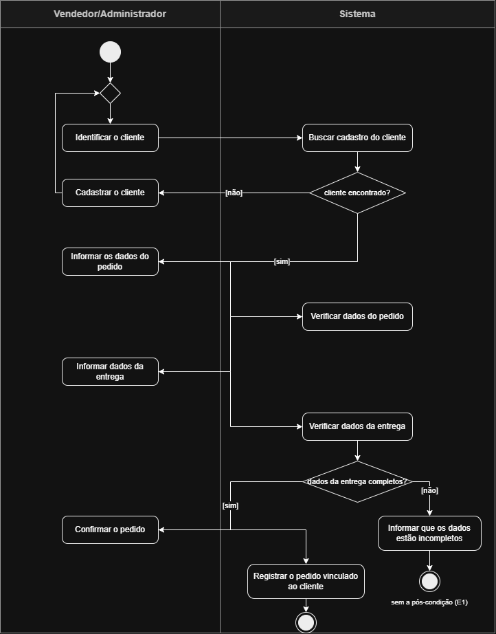

# 4.2.5 Modelagem de Atividade

## Do fluxo ao diagrama

O diagrama de atividades é o fluxo da 4.2.2 desenhado. A fonte é a especificação de **Registrar pedido**: o fluxo principal, o alternativo A1 e a exceção E1. Nada entra no desenho que não esteja lá.

Três regras de tradução. Cada passo vira uma ação, na raia de quem faz. Cada "o sistema confirma" ou "o sistema verifica" vira uma ação seguida de uma decisão, porque verificar é perguntar. E cada alternativo ou exceção vira uma saída da decisão: o alternativo volta ao fluxo por uma junção, a exceção termina num fim próprio.

| No fluxo da 4.2.2 | Vira | Raia | Por quê |
|---|---|---|---|
| passo 1: o Vendedor/Administrador identifica o cliente | ação **Identificar o cliente** | Vendedor/Administrador | quem age é o ator, e a ação fica na raia dele |
| passo 2: o sistema apresenta os dados cadastrados do cliente | ação **Buscar cadastro do cliente** e decisão _cliente encontrado?_ | Sistema | apresentar os dados exige consultar o cadastro; da resposta [não] sai o alternativo A1 |
| A1: o cliente não está cadastrado, o vendedor cadastra o cliente e o fluxo volta ao passo 1 | saída [não] da primeira decisão, ação **Cadastrar o cliente** e uma **junção** antes de Identificar o cliente | Vendedor/Administrador | alternativo é desvio que volta. A junção é o ponto em que o caminho novo encontra o caminho principal |
| passo 3: o Vendedor/Administrador informa os dados do pedido | ação **Informa os dados do pedido** | Vendedor/Administrador | ação do ator |
| passo 4: o sistema verifica os dados informados | ação **Verificar dados do pedido** | Sistema | validação dos itens do pedido pelo sistema |
| passo 5: o Vendedor/Administrador informa os dados da entrega | ação **Informar dados da entrega** | Vendedor/Administrador | ação do ator |
| passo 6: o sistema verifica os dados da entrega | ação **Verificar dados da entrega** e decisão _dados da entrega completos?_ | Sistema | verificar é perguntar. A exceção E1 sai do [não] |
| E1: dados incompletos para entrega, o sistema avisa e não registra | saída [não], ação **Informar que os dados estão incompletos** e um **fim** próprio | Sistema | exceção não volta. O caso termina sem a pós-condição, e o fim diz isso |
| passo 7: o Vendedor/Administrador confirma o pedido | ação **Confirmar o pedido** | Vendedor/Administrador | ação do ator |
| passo 8: o sistema registra o pedido vinculado ao cliente | ação **Registrar o pedido vinculado ao cliente**, e o **fim** do caminho feliz | Sistema | o passo que entrega a pós-condição. É o único fim com ela |

## Diagrama de atividades

**Figura 2 – Diagrama de atividades de Registrar pedido**

Fonte: Autoria própria (2026).

A Figura 2 tem duas raias. A da esquerda é do **Vendedor/Administrador**, a da direita é do **Sistema**. Cada ação está na raia de quem a faz, e as setas cruzam de uma raia para a outra toda vez que a vez passa de um para o outro. Lendo de cima para baixo, o desenho é o fluxo de atendimento da 4.2.2.

O círculo cheio no alto é o **início**. Logo abaixo dele há uma **junção**, o losango sem pergunta: é por ali que o caminho do A1 volta, depois de cadastrar o cliente. As duas **decisões** são os losangos com pergunta, e cada uma tem duas saídas com a guarda entre colchetes: [sim] e [não].

Há dois **fins**. O de baixo, na raia do Sistema, é o único em que a pós-condição acontece: o pedido registrado e vinculado ao cliente com os dados da entrega. O da direita é o fim da E1, que avisa sobre os dados incompletos e encerra sem registrar. Um caso de uso que pode terminar de dois jeitos tem dois fins.

Não há barra de sincronização (as duas barras grossas que separam e juntam caminhos paralelos). Nada em Registrar pedido acontece ao mesmo tempo: é um processo sequencial de digitação e validação, uma coisa depois da outra.

## Rastreabilidade com a 4.2.2

| Elemento do diagrama | Vem de | Confere |
|---|---|---|
| Identificar o cliente, Informar os dados do pedido, Informar dados da entrega, Confirmar o pedido | passos 1, 3, 5 e 7 (o Vendedor/Administrador) | quatro ações na raia do ator, uma por passo do fluxo principal |
| Buscar cadastro do cliente, Verificar dados do pedido, Verificar dados da entrega, Registrar o pedido vinculado ao cliente | passos 2, 4, 6 e 8 (o Sistema) | quatro ações na raia do sistema, organizando consultas e verificações |
| cliente encontrado? [não] | A1 (no passo 2) | volta por junção para a ação Cadastrar o cliente, retornando ao início |
| dados da entrega completos? [não] | E1 (no passo 6) | termina em fim próprio com mensagem de erro, como exceção |
| fim com a pós-condição | pós-condição da 4.2.2 | só o caminho feliz chega nele |

**Todo passo tem elemento.** Os oito passos, o A1 e a E1 estão no desenho, e nenhum elemento do desenho veio de fora da especificação da 4.2.2.

**Toda decisão tem as duas saídas.** Cada losango com pergunta tem um [sim] e um [não], levando respectivamente ao fluxo principal ou aos desvios (A1 e E1).

**O que o desenho mudou.** Desenhar destacou que a verificação dos dados da entrega no passo 6 exige uma decisão explícita no diagrama (_dados da entrega completos?_) para isolar o fluxo de erro da E1. A especificação da 4.2.2 permanece coerente e alinhada com essa representação.